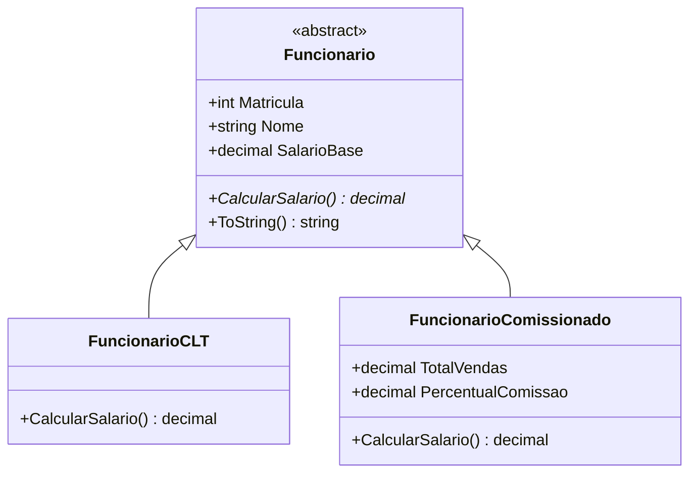

# 👥 Gestão de Funcionários


> 🎓 Projeto desenvolvido em aula na disciplina **Programação I** do curso de **Sistemas de Informação** da **UEMG – Unidade Passos**, com o objetivo de aplicar na prática os conceitos de **Programação Orientada a Objetos (POO)** usando **C#**.

---

## 📌 Sumário

- [Sobre o projeto](#-sobre-o-projeto)
- [Objetivos de aprendizagem](#-objetivos-de-aprendizagem)
- [Conceitos de POO aplicados](#-conceitos-de-poo-aplicados)
- [Diagrama de classes](#-diagrama-de-classes)
- [Arquitetura em camadas](#-arquitetura-em-camadas)
- [Estrutura de pastas](#-estrutura-de-pastas)
- [Banco de dados](#-banco-de-dados)
- [Como executar](#-como-executar)
- [Próximos passos](#-próximos-passos)

---

## 💡 Sobre o projeto

O sistema permite **cadastrar funcionários** de uma empresa e **calcular a remuneração** de cada um.

Existem dois tipos de funcionário:

| Tipo | Como o salário é calculado |
|------|----------------------------|
| 🧾 **CLT** | Recebe apenas o **salário base**. |
| 💼 **Comissionado** | Recebe o **salário base + comissão** sobre o total de vendas. |

📐 Fórmula do comissionado:

```
salário = salário base + (total de vendas × percentual de comissão ÷ 100)
```

> Exemplo: salário base de R$ 2.000,00, vendas de R$ 10.000,00 e comissão de 5% → **R$ 2.500,00**

---

## 🎯 Objetivos de aprendizagem

Ao estudar este projeto, você vai praticar:

- ✅ Criação de **classes** e **objetos**
- ✅ **Construtores** e o uso de `base(...)`
- ✅ **Propriedades** (`get; set;`)
- ✅ **Classes abstratas** e **métodos abstratos**
- ✅ **Herança** e **polimorfismo**
- ✅ Verificação de tipo com `is` (o `instanceof` do Java)
- ✅ Separação do código em **camadas** (Model, Data, View)
- ✅ Acesso a **banco de dados MySQL** com o padrão **DAO**
- ✅ Construção de telas com **Windows Forms**

---

## 🧠 Conceitos de POO aplicados

### 1️⃣ Abstração

A classe `Funcionario` representa a **ideia geral** de um funcionário. Ela é `abstract`, ou seja, **não pode ser instanciada diretamente** — não existe "um funcionário genérico", só CLT ou Comissionado.

```csharp
public abstract class Funcionario
{
    public int     Matricula   { get; set; }
    public string  Nome        { get; set; }
    public decimal SalarioBase { get; set; }

    // Cada tipo de funcionário é OBRIGADO a dizer como calcula o salário
    public abstract decimal CalcularSalario();
}
```

### 2️⃣ Herança

As classes filhas **herdam** tudo o que `Funcionario` tem. Em C#, os **dois pontos (`:`)** fazem o papel do `extends` do Java.

```csharp
public class FuncionarioCLT : Funcionario
{
    public FuncionarioCLT(int matricula, string nome, decimal salarioBase)
        : base(matricula, nome, salarioBase)   // chama o construtor da classe mãe
    { }
}
```

A classe `FuncionarioComissionado` herda de `Funcionario` e **acrescenta** suas próprias propriedades: `TotalVendas` e `PercentualComissao`.

### 3️⃣ Polimorfismo

O mesmo método, `CalcularSalario()`, tem **comportamentos diferentes** em cada classe, graças ao `override`:

```csharp
// FuncionarioCLT
public override decimal CalcularSalario()
{
    return SalarioBase;
}

// FuncionarioComissionado
public override decimal CalcularSalario()
{
    return SalarioBase + (TotalVendas * PercentualComissao / 100m);
}
```

Na tela, o código **não precisa saber** qual é o tipo do funcionário — basta chamar o método:

```csharp
Funcionario funcionario = lstFuncionario[posicao];
txtSalarioCalculado.Text = $"{funcionario.CalcularSalario():C2}";
```

🪄 O C# decide **em tempo de execução** qual versão do método executar. Isso é polimorfismo!

### 4️⃣ Encapsulamento

Os dados ficam guardados em **propriedades** da própria classe, e a regra de cálculo fica **dentro** do objeto. Quem usa a classe não precisa saber como o salário é calculado — só pede o resultado.

### 5️⃣ Verificação de tipo com `is`

Quando é preciso acessar algo específico de uma classe filha, usamos `is` com **conversão automática**:

```csharp
if (funcionario is FuncionarioComissionado fc)
{
    // aqui dentro, "fc" já é um FuncionarioComissionado
    txtTotalVendas.Text = fc.TotalVendas.ToString();
}
```

### 6️⃣ Sobrescrita de `ToString()`

Todo objeto em C# herda de `object`. Sobrescrevendo `ToString()`, definimos como o funcionário aparece em formato de texto:

```csharp
public override string ToString()
{
    return $"Matrícula: {this.Matricula} | Nome: {this.Nome}";
}
```

---

## 🗺️ Diagrama de classes



---

## 🏛️ Arquitetura em camadas

O projeto é dividido em **três camadas**, cada uma com uma responsabilidade:

```
┌──────────────────────────────┐
│  🖥️  View   (Form1)           │  ← Tela: o que o usuário vê e clica
└──────────────┬───────────────┘
               │
┌──────────────▼───────────────┐
│  📦 Model  (Funcionario...)   │  ← Regras de negócio: classes e cálculos
└──────────────┬───────────────┘
               │
┌──────────────▼───────────────┐
│  🗄️  Data   (FuncionarioDAO)  │  ← Acesso ao banco de dados MySQL
└──────────────────────────────┘
```

| Camada | Pasta | Responsabilidade |
|--------|-------|------------------|
| 🖥️ **View** | `View/` | Formulário Windows Forms com os botões **Novo**, **Gravar**, **Anterior**, **Próximo** e **Calcular Remuneração**. |
| 📦 **Model** | `Model/` | Classes que representam os funcionários e suas regras. |
| 🗄️ **Data** | `Data/` | Conexão com o MySQL (`ConexaoBD`) e operações de banco (`FuncionarioDAO`). |

### 🧰 O padrão DAO

**DAO** (*Data Access Object*) é uma classe que **concentra todo o acesso ao banco**. Assim, a tela não precisa conhecer SQL.

| Método | O que faz | Comando SQL |
|--------|-----------|-------------|
| `Inserir(funcionario)` | Grava um novo funcionário | `INSERT` |
| `Atualizar(funcionario)` | Altera um funcionário existente | `UPDATE` |
| `Excluir(matricula)` | Remove um funcionário | `DELETE` |
| `Buscar(matricula)` | Procura um funcionário pela matrícula | `SELECT ... WHERE` |
| `Listar()` | Retorna todos os funcionários | `SELECT ... ORDER BY` |

🔒 Todos os comandos usam **parâmetros** (`@matricula`, `@nome`, ...), o que protege o sistema contra **SQL Injection**.

---

## 📁 Estrutura de pastas

```
GestaoFuncionarios/
└── GestaoFuncarios/
    ├── 📄 banco_dados.sql            → script de criação do banco
    ├── 📄 GestaoFuncarios.sln        → solução do Visual Studio
    └── GestaoFuncarios/
        ├── 📄 Program.cs             → ponto de entrada da aplicação
        ├── 📂 Model/
        │   ├── Funcionario.cs        → classe abstrata (mãe)
        │   ├── FuncionarioCLT.cs     → classe filha
        │   └── FuncionarioComissionado.cs → classe filha
        ├── 📂 Data/
        │   ├── ConexaoBD.cs          → string de conexão com o MySQL
        │   └── FuncionarioDAO.cs     → operações no banco
        └── 📂 View/
            └── Form1.cs              → tela do sistema
```

---

## 🗄️ Banco de dados

O script `banco_dados.sql` cria o banco `gestao_funcionario` e a tabela `funcionarios`:

| Coluna | Tipo | Observação |
|--------|------|------------|
| `matricula` | `int` | 🔑 Chave primária |
| `nome` | `varchar(120)` | Obrigatório |
| `tipo` | `varchar(20)` | Apenas `CLT` ou `COMISSIONADO` |
| `salario_base` | `decimal(12,2)` | Obrigatório |
| `total_vendas` | `decimal(12,2)` | Só para comissionados |
| `percentual_comissao` | `decimal(5,2)` | Só para comissionados |

💡 Repare que **duas classes** (CLT e Comissionado) são guardadas em **uma única tabela**. A coluna `tipo` indica qual classe deve ser criada ao ler o registro — e as colunas de comissão ficam `NULL` para os CLT.

---

## ▶️ Como executar

### 📋 Pré-requisitos

- 🪟 Windows
- 🛠️ [Visual Studio 2022](https://visualstudio.microsoft.com/) com a carga de trabalho **Desenvolvimento para desktop com .NET**
- ⚙️ [.NET 6 SDK](https://dotnet.microsoft.com/download/dotnet/6.0)
- 🐬 [MySQL Server](https://dev.mysql.com/downloads/) (ou XAMPP / WampServer)

### 🚀 Passo a passo

1. **Clone o repositório**
   ```bash
   git clone <url-do-repositorio>
   ```

2. **Crie o banco de dados** executando o script `GestaoFuncarios/banco_dados.sql` no MySQL Workbench (ou outro cliente MySQL).

3. **Confira a conexão** em `Data/ConexaoBD.cs` e ajuste usuário e senha, se necessário:
   ```csharp
   "Server=localhost;Port=3306;Database=gestao_funcionario;User ID=root;Password=;"
   ```

4. **Abra a solução** `GestaoFuncarios.sln` no Visual Studio.

5. Pressione **F5** ▶️ para compilar e executar.
   > O pacote NuGet **MySqlConnector** é baixado automaticamente na primeira compilação.

---

## 🔭 Próximos passos

Este projeto está **em construção** junto com a turma. Próximas etapas previstas em aula:

- [ ] 🔗 Ligar a tela (`Form1`) ao `FuncionarioDAO`, para gravar os dados no MySQL
- [ ] 🛡️ Melhorar a validação dos campos numéricos (salário, vendas e comissão)
- [ ] ✏️ Corrigir e testar a atualização de funcionários
- [ ] 🗑️ Adicionar o botão de exclusão

---

<p align="center">
  Feito com 💙 pela turma de <b>Programação I</b> — <b>Sistemas de Informação</b><br>
  🏫 <b>UEMG – Unidade Passos</b>
</p>
